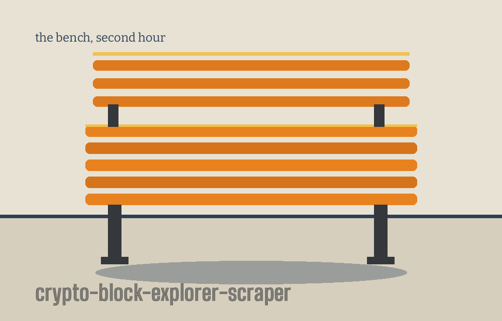
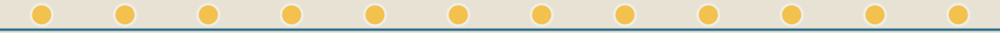

# crypto-block-explorer-scraper

Title block: a night watch log entry, the hour noted at the left. The name above is set in Big Shoulders Inline Text SC in sodium orange on tile pale, ruled beneath, with a small bench beside this first heading only. Hour: second hour. Later headings keep the rule and the hour without the drawing.

# crypto-block-explorer-scraper

Scrapes and aggregates data from multiple block explorer APIs (e.g., Etherscan, Blockchair) for a given cryptocurrency address or transaction hash, providing a consolidated view of its activity and history. - Focused on Basic cryptographic operations

## Install

> Notice pinned beside the machines: Etherscan will not answer at all unless the caller has set the environment variable named ETHERSCAN_API_KEY. The name is printed here and no value for it is printed anywhere in this set.

`git clone https://github.com/ShadowGuardAI/crypto-block-explorer-scraper`

Flagged where it stands, and corrected nowhere in this README: the clone line above names the organisation without the hyphen its account carries. The website records the fault in a note beneath the same line.

## Usage

> Notice pinned beside the machines: when both sources fail, the run logs that no data could be fetched from either source and exits 1, rather than printing an empty result as though the address were quiet.

`./crypto-block-explorer-scraper [params]`

## Parameters

> Notice pinned beside the machines: only one option branch runs on any single invocation, because the programme tests its options in a fixed order, address before hash, hash before the password and message work, and key generation last.

- `--address`: The cryptocurrency address to search for.

- `--txhash`: The transaction hash to search for. Queried as a transaction at both APIs, not as an address.

- `--password`: Password to use for crypto operations. WARNING: Use with extreme caution. Avoid using plaintext passwords on CLI, consider using other secure methods.

- `--hash_password`: Hashes a password. Requires --password.

- `--verify_password`: No description provided

- `--encrypt`: No description provided

- `--decrypt`: No description provided

- `--generate_key`: Generates an AES key.

## License

> Notice pinned beside the machines: hashed and generated material printed by a run is material to keep private, since a printed salt, hash, or key is a copy of the thing itself.

Copyright (c) ShadowGuardAI

Flagged where it stands: the licence line above uses the same unhyphenated form, the second of two occurrences counted in the governing prose. The separate LICENSE file carries the MIT License, and its holder line gives a pen name together with a single initial.

## Facts from the code, stated in the prose

This record names: ETHERSCAN_API_KEY, Etherscan, Blockchair, PBKDF2HMAC, SHA256, 390000, 32, AES, CBC, PKCS7, 256 bit, five calls a second for Etherscan, two calls a second for Blockchair, ten seconds, exits 1, python3 main.py, cryptography, requests, MIT License.
